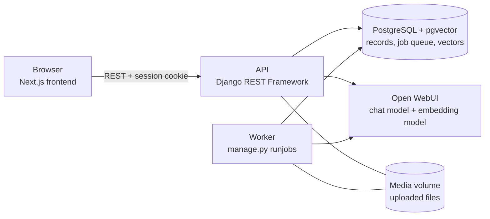

# BiasHawk Documentation

BiasHawk audits the data behind an AI system. You describe the system by uploading its documentation, attach one or more tabular datasets, and BiasHawk profiles the data, checks its quality, identifies sensitive attributes, measures group and intersectional fairness, compares dataset versions for drift, and maps the findings onto the NIST AI Risk Management Framework with an EU AI Act view. Every result can be read in the browser or downloaded as a PDF report.

This document is written for researchers and data scientists. It explains what each analysis computes, with the exact formulas, thresholds and defaults the code uses; where a language model is involved and where it is not; how to drive BiasHawk programmatically; and which results need care when you interpret them. Installation, deployment and environment variables are covered in [README.md](README.md).

**Conventions.** Prose uses British spelling, as the interface does ("favourable"). Identifiers keep the spelling of the code (`favorable_outcome`). Thresholds are stated exactly as the code applies them: "above 0.10" means strictly greater than 0.10. File paths are relative to the repository root.

## Contents

1. [What BiasHawk does](#1-what-biashawk-does)
2. [Core concepts](#2-core-concepts)
3. [Architecture](#3-architecture)
4. [Workflow in the web app](#4-workflow-in-the-web-app)
5. [Preparing your data](#5-preparing-your-data)
6. [Methodology](#6-methodology)
   - [6.1 Document ingestion and retrieval](#61-document-ingestion-and-retrieval)
   - [6.2 Metadata extraction](#62-metadata-extraction)
   - [6.3 Data governance profile](#63-data-governance-profile)
   - [6.4 Data quality](#64-data-quality)
   - [6.5 Sensitive feature detection](#65-sensitive-feature-detection)
   - [6.6 Bias and fairness assessment](#66-bias-and-fairness-assessment)
   - [6.7 Bias reports and explanations](#67-bias-reports-and-explanations)
   - [6.8 Drift](#68-drift)
   - [6.9 NIST AI RMF risk assessment](#69-nist-ai-rmf-risk-assessment)
7. [How the language model is used](#7-how-the-language-model-is-used)
8. [Outputs and data formats](#8-outputs-and-data-formats)
9. [Programmatic access: the REST API](#9-programmatic-access-the-rest-api)
10. [Using the analysis code directly in Python](#10-using-the-analysis-code-directly-in-python)
11. [Reproducibility](#11-reproducibility)
12. [Interpreting results: limitations and caveats](#12-interpreting-results-limitations-and-caveats)
13. [Configuration that affects results](#13-configuration-that-affects-results)
14. [Running BiasHawk](#14-running-biashawk)
15. [Glossary](#15-glossary)
16. [References](#16-references)

---

## 1. What BiasHawk does

| Module | Question it answers | Engine | Main output |
|---|---|---|---|
| Document ingestion | What do the system's own documents say? | Chunking, embeddings, vector search, cross-encoder reranking | Searchable passages |
| Metadata extraction | Who provides the system, what is it for, how is its data handled? | Retrieval, then one LLM call per record | AI System Documentation (25 questions) and AI Data Compliance Form (21 questions) |
| Data governance | What does the dataset look like? | Deterministic profile, LLM write-up | Data profile and governance report |
| Data quality | Is the data complete, consistent and clean? | Six rule-based checks, LLM write-up | Per-column metrics, findings with severities, report |
| Sensitive features | Which columns are protected attributes or likely proxies? | Keyword knowledge base plus one LLM verdict per column | Ranked suggestions |
| Bias assessment | Are outcomes, representation and learnability even across groups and their intersections? | pandas, SciPy, scikit-learn | Metrics, warnings, executive report |
| Drift | Has the data, or its fairness, changed between two versions? | KS, PSI, Jensen-Shannon and chi-square tests; metric deltas | Drift record and report |
| Risk assessment | What do these findings mean against the NIST AI RMF and the EU AI Act? | Rule-based scoring and mapping, two LLM paragraphs | Risk level and score, prioritised actions, report |

Two points shape how every result should be read.

**BiasHawk audits datasets, not models.** It never receives a trained model, a prediction function or model scores. Fairness metrics are computed from the outcome column exactly as it appears in the CSV. Where a report mentions model performance, it refers to random-forest classifiers that BiasHawk trains on the dataset itself ([section 6.6.3](#663-performance-disparity)), not to your system's model. To audit the behaviour of a deployed model, export a dataset whose outcome column holds that model's decisions and analyse that dataset.

**Measurements and narratives are separate.** Every number, verdict and severity is produced by deterministic Python code with fixed thresholds and fixed random seeds. The narrative reports, the metadata extracted from documents and one of the two passes of sensitive-feature detection are produced by a large language model (LLM). The LLM summarises the measurements; it does not produce them, and its text can contain errors. [Section 7](#7-how-the-language-model-is-used) lists every place an LLM is used.

---

## 2. Core concepts

```
Account
└── Use case                  an AI system under assessment
    │   system documents      PDF, DOCX, TXT, MD  ->  AI System Documentation
    ├── Instance A            one dataset of that system: a snapshot, version or split
    │   ├── source dataset    one CSV
    │   ├── data documents    ->  AI Data Compliance Form
    │   └── results           governance, quality, sensitive features, bias, risk
    ├── Instance B
    └── Drift comparison      A (baseline) against B (comparison)
```

**Use case.** An AI system under assessment, for example a loan approval model. It holds the system's documentation and the *AI System Documentation* record extracted from it.

**Instance.** One dataset belonging to a use case: a snapshot in time, a version, or a split such as training data against production decisions. An instance holds one source CSV, optional data documentation, the *AI Data Compliance Form* extracted from that documentation, and the results of every analysis run on it.

**Job.** One run of one analysis on a use case or an instance. Jobs are queued in the database and executed by a background worker; the browser polls until they finish.

**Drift comparison.** Two instances of the same use case: a baseline (earlier) instance and a comparison (later) instance.

**Ownership.** Every object belongs to the account that created it. Queries are filtered by owner in the data layer, so another account's objects are not merely forbidden but invisible: requesting one returns 404.

**Storage and deletion.** Uploaded files are kept on the server's media volume and are served only through download endpoints that check ownership; there is no public file URL. Deleting a document, dataset, instance or use case deletes its records, and the files are removed from disk once the deletion is committed. Deleting a use case removes its instances, documents, analyses and drift comparisons with it. Deleting a dataset leaves the results already computed from it in place.

---

## 3. Architecture



| Component | Role |
|---|---|
| Frontend | Next.js web app. Holds no secrets and talks only to the API. |
| API | Django and Django REST Framework. Validates uploads, stores results, enqueues jobs, serves reports and PDFs. No analysis runs inside a request; document question answering, which retrieves passages and calls the LLM while the client waits, is the one exception. |
| Worker | The same image as the API with a different entrypoint. Runs eight threads by default; each claims queued jobs with `SELECT ... FOR UPDATE SKIP LOCKED`, so no job runs twice. A failed job is retried up to three attempts in total, and a job whose worker died is returned to the queue after 30 minutes. |
| PostgreSQL 17 with pgvector | Application records, the job queue and all embeddings. |
| Open WebUI | An OpenAI-compatible API serving the chat model and the embedding model. The analyses' only external dependency. |
| Reranker | A small cross-encoder that runs in-process on CPU, because Open WebUI has no reranking endpoint. |

Where to find the code:

| Path | Contents |
|---|---|
| [`backend/core/analysis/`](backend/core/analysis/) | The measurements: [`bias.py`](backend/core/analysis/bias.py), [`associations.py`](backend/core/analysis/associations.py), [`thresholds.py`](backend/core/analysis/thresholds.py), [`quality.py`](backend/core/analysis/quality.py), [`governance.py`](backend/core/analysis/governance.py), [`sensitive.py`](backend/core/analysis/sensitive.py), [`sensitive_kb.py`](backend/core/analysis/sensitive_kb.py), [`data_drift.py`](backend/core/analysis/data_drift.py), [`bias_drift.py`](backend/core/analysis/bias_drift.py), [`bias_explanations.py`](backend/core/analysis/bias_explanations.py). Plain pandas and scikit-learn, no web framework. |
| [`backend/core/jobs/`](backend/core/jobs/) | One handler per job kind; [`registry.py`](backend/core/jobs/registry.py) maps kinds to handlers. The handlers hold the LLM prompts. |
| [`backend/core/rag/`](backend/core/rag/) | Document loaders, chunking and embedding, retrieval and answering. |
| [`backend/core/agents/`](backend/core/agents/) | Extraction schemas, questions and pipeline. |
| [`backend/core/risk/`](backend/core/risk/) | The NIST risk pipeline. |
| [`backend/core/data/NIST.AI.600-1.pdf`](backend/core/data/NIST.AI.600-1.pdf) | The NIST corpus used for guidance retrieval. |
| [`backend/core/llm.py`](backend/core/llm.py) | The only LLM client. |
| [`backend/core/reports.py`](backend/core/reports.py) | Markdown to PDF rendering. |
| [`frontend/`](frontend/) | The web app. |

---

## 4. Workflow in the web app

### 4.1 Sign in

Sign in with email and password, or with Google or GitHub when the deployment has them configured. Self-service sign-up is hidden in the web app; ask whoever operates your BiasHawk deployment for an account.

### 4.2 Create a use case

Go to **Project Setup** and choose **New use case**. The dialog has eight steps: Autofill, General, Overview, Model, Oversight, Security, Logging and GDPR.

- **Autofill.** Upload a document describing the system. BiasHawk indexes it ([6.1](#61-document-ingestion-and-retrieval)) and fills in the other steps from it ([6.2](#62-metadata-extraction)). This takes from under a minute to several minutes; the dialog can be minimised meanwhile.
- **Review every step.** Extraction answers "unknown" or "No" wherever the documents are silent, and these answers feed the governance score of the risk assessment ([6.9.1](#691-governance)). The review is the only human check in that chain.

### 4.3 Create instances

Open the use case and choose **New instance**. The steps are Autofill (data documentation), Dataset (the CSV), Overview, Origin, Quality, Governance and Monitoring. Each instance holds one CSV; uploading another replaces it. Create one instance per dataset version you want to compare later, for example `2024-Q1` and `2024-Q2`, or `training data` and `production decisions`.

### 4.4 Run the analyses

Selecting an instance points the sidebar at it. Every analysis page acts on the selected instance.

| Page | What you do | Jobs it runs |
|---|---|---|
| Data Governance | Run | `data_governance` |
| Data Quality | Run | `data_quality`, then `risk_assessment` |
| Bias Analysis, Setup | Optionally run the detector; pick the sensitive features, the target column and the favourable outcome; Run | `sensitive_features`; `bias_assessment`, then `bias_report` and `risk_assessment` |
| Bias Analysis, Report | Read the metric cards and their explanations; download the three bias reports | `bias_report` on demand |
| Bias Drift | Pick a baseline instance; Run | `drift` |
| Risk Assessment | Read the result; run it again after a drift comparison | `risk_assessment` |

Jobs run in the background. While one is queued or running, pages poll every three seconds; you can leave and come back. **User Files** lists every upload.

### 4.5 Automatic follow-up jobs

| Event | Follow-up |
|---|---|
| A document is uploaded to a use case or an instance | `rag_ingest` of that scope, then `usecase_extract` or `instance_extract` |
| A document is deleted | `rag_ingest` of the remaining documents, or the scope's passages are cleared when none remain |
| `data_quality` finishes | `risk_assessment` |
| `bias_assessment` finishes | `bias_report` and `risk_assessment` |
| `drift` finishes | Nothing. Run the risk assessment again to include the comparison. |

Requesting a job of a kind that is already queued for the same scope returns the queued job rather than adding a duplicate (every kind except `drift`). A request made while the same kind is running queues one follow-up run, so newer input is never skipped.

---

## 5. Preparing your data

### 5.1 The CSV file

- Comma-separated, with a header row, UTF-8 encoded. The file is read with `pandas.read_csv` defaults: no delimiter detection and no date parsing. Empty cells and the usual markers (`NA`, `N/A`, `NaN`, `null` and similar) are missing values.
- The upload is rejected if pandas cannot parse it or it has no columns. On upload the API records the number of rows and the number of distinct values per column, which the bias setup uses to tell which columns can be compared.
- The column types pandas infers decide how BiasHawk treats a column. Numeric columns are treated as numeric everywhere (correlation measures, KS and PSI drift tests, z-score outliers); everything else is treated as categorical. Category codes stored as numbers (1 = single, 2 = married) are therefore numeric to BiasHawk. Store categories as text labels.
- Dates are read as text.
- Each analysis reads the whole file into memory.

### 5.2 Target column and favourable outcome

- **Target column** (`label`): the outcome you want to audit. It can be a ground-truth outcome, a human decision or a model's prediction. It must be categorical. Binary targets are the usual case; with more classes, the favourable value is compared against all other values combined in the fairness metrics, and performance is a weighted F1 across all classes.
- **Favourable outcome** (`favorable_outcome`): the value that counts as the good result, such as `good`, `approved` or `hired`. Matching is exact, and it is case-sensitive and type-sensitive.
- **Use text labels in the target column when you work in the web app.** The setup form sends the favourable outcome as text. When the target column is numeric (for example 0 and 1), the text `"1"` does not match the number `1`: every group's favourable rate comes out as 0, Statistical Parity is reported as 0.00 and Disparate Impact as 1.00 (both passing), and the warnings report says `Favorable outcome '1' not found`. Recode the target as text (for example `approved` and `denied`) before uploading, or submit the job through the API with a JSON number ([section 9](#9-programmatic-access-the-rest-api)).
- The setup page preselects a column named `risk`, `label`, `target`, `outcome`, `approved` or `default` as the target.

### 5.3 Sensitive features

- You choose them on the setup page, or send them in the API payload. The detector ([6.5](#65-sensitive-feature-detection)) only makes suggestions.
- A sensitive feature must be **groupable**: at most 50 distinct values, and at least 10 rows per value on average (rows divided by distinct values). The web app shows other columns struck through and does not let you select them. Through the API they are accepted, left out of the group comparisons with a warning, and still checked as proxies and for predictability.
- Band continuous attributes before uploading: age into age bands, income into quantiles.
- Impute or drop missing values in sensitive columns. They are not treated as a group in the fairness metrics or the representation counts (those rows still count in the denominator of representation shares), yet the model-based tests see them as a value of their own, so results are easiest to read without them.
- Every pair of selected groupable features is analysed as an intersection. Selecting *k* features gives *k(k-1)/2* intersections, each needing a classifier per subgroup, so runtime grows quickly with *k*.

### 5.4 Other columns

Every column that is neither the target nor a selected sensitive feature is used as a predictor in the random-forest tests and is screened as a potential proxy. Before uploading:

- **Remove identifiers** such as row IDs, names, emails and free text. They are label-encoded and fed to the classifiers; an ID column makes every row unique, which hides duplicate rows; and personal values would appear in the governance profile and the LLM prompts.
- **Remove columns derived from the target.** They make the performance test meaningless and show up as strong proxies.
- **Remove columns that are entirely empty.** In a drift comparison they can make the job fail ([section 12](#12-interpreting-results-limitations-and-caveats)).

### 5.5 Sample size

BiasHawk reports point estimates. Apart from the drift tests, it computes no confidence intervals or significance tests. Rates measured on small groups are noisy, and the max-minus-min metrics are driven by the extreme groups, which are often the smallest. The representativity results ([6.6.4](#664-representativity)) give every group's count; read them alongside the fairness metrics, and treat groups or intersections of a few dozen rows or fewer as indicative only.

### 5.6 Documents

- Supported: PDF (with a text layer; a scanned PDF without OCR yields no text), DOCX (paragraphs, then table rows), TXT and Markdown (`.md`, `.markdown`). Anything else, including `.doc`, images and spreadsheets, is rejected at upload. If none of a scope's documents yields text, ingestion fails.
- Use-case documents describe the system: model cards, technical documentation, DPIAs, conformity assessments. Instance documents describe the dataset: datasheets, data management plans. Instance extraction reads both.

---

## 6. Methodology

### 6.1 Document ingestion and retrieval

**Ingestion** (job `rag_ingest`) runs per scope, either a use case or an instance:

1. **Load.** PDFs page by page (pypdf text extraction), DOCX as paragraphs followed by table rows (cells joined with ` | `), TXT and Markdown as UTF-8 text.
2. **Split.** A recursive character splitter cuts passages of at most 1,000 characters with 200 characters of overlap, preferring to break at paragraph, then line, then sentence (`. `), then word boundaries.
3. **Embed.** Passages are embedded in batches of 32 with `nomic-embed-text:v1.5`, served by Open WebUI. Vectors have 768 dimensions and are scaled to unit length.
4. **Store.** Passages and vectors go into PostgreSQL with pgvector, under an HNSW index (m = 16, ef_construction = 64, L2 distance). Ingestion replaces all passages of the scope in one transaction.

**Scope.** A use case retrieves from its own documents only. An instance retrieves from its own documents and its use case's.

**Retrieval:**

1. The query is embedded. With HyDE enabled, an LLM-written hypothetical answer is embedded instead; HyDE is off by default.
2. The 30 passages nearest by L2 distance are fetched. For unit vectors this ranks exactly as cosine similarity does.
3. A cross-encoder, `cross-encoder/ms-marco-MiniLM-L-6-v2`, scores every (query, passage) pair and the best 3 are kept. If the reranker fails, the vector order is kept.

Vector distance provides recall and the cross-encoder provides precision, which is why the candidate pool (30) is much larger than what is kept (3). HyDE is off because it hurts factual lookups, which is what extraction does: asked which organisation provides a system, the model invents a plausible name, and embedding that invention pulls retrieval towards the wrong document.

**Question answering** is available through the API only (`POST .../rag/query`, [section 9](#9-programmatic-access-the-rest-api)). It retrieves as above and asks the LLM to answer from the retrieved passages alone, citing source file and chunk number, and to say so when they do not contain the answer.

### 6.2 Metadata extraction

Jobs `usecase_extract` and `instance_extract` fill two fixed records whose schemas live in [`backend/core/agents/schemas.py`](backend/core/agents/schemas.py), together with the questions put to the documents.

**AI System Documentation** (use case, 25 questions):

| Section | Fields |
|---|---|
| General information | AI system name, version and release date, provider organisation, responsible person or team, contact information |
| System overview | Intended purposes, domain of use, user groups (list), deployment environment, risk category |
| Model and algorithms | Model type, training algorithms, explainability techniques (list), validation methodology |
| Human oversight | Human in the loop (yes/no), oversight procedures (list), user training (list) |
| Cybersecurity | Security measures (list), robustness |
| Logging and documentation | Logs maintained (yes/no), retention period, auditability (list) |
| GDPR conformity assessment | Assessment performed (yes/no), notified body, outcome |

**AI Data Compliance Form** (instance, 21 questions):

| Section | Fields |
|---|---|
| Data overview | Description, types of data (list), sources, purpose, high-risk data handling (yes/no) |
| Collection and origin | Collected from (list), consent mechanism documented, anonymisation or pseudonymisation applied, sensitive data included (all yes/no) |
| Quality assurance | Cleaning steps (list), missing-data handling, duplicate removal, preprocessing methods (list), validation methods |
| Management and governance | Retention policy, access controls (list), lineage and provenance tracked (yes/no), minimisation measures (list), storage location and jurisdiction, GDPR compliance (yes/no) |
| Monitoring and updates | Update frequency, user feedback used in updates (yes/no) |

**Procedure:**

1. Each question is used for **retrieval only**: no HyDE and no LLM call per question.
2. The passages found for all questions are merged, deduplicated, ordered by vector distance and capped at 40,000 characters.
3. One LLM call receives the passages, the questions and an empty JSON skeleton of the record. It is told to use only the context and to answer `"unknown"`, `false` or `["unknown"]` where the context is silent.
4. The reply is validated against the schema. If validation fails, the model is asked once more with the validation errors; a second failure fails the job.

Every field has a default, so a partial answer degrades field by field instead of failing outright. Note the asymmetry this creates: an unanswered yes/no question becomes `false`, and the risk assessment reads `false` as evidence that the control is absent ([6.9.1](#691-governance)). Both records can be corrected in the edit dialogs, or through the API, before the risk assessment runs.

### 6.3 Data governance profile

Job `data_governance` produces two documents.

**Data profile** (deterministic, [`governance.py`](backend/core/analysis/governance.py)):

- Rows, columns, memory usage, and duplicate rows with their share.
- Column counts by type family (numeric, text, category, datetime, boolean) and each column's pandas dtype.
- Missing values per affected column, as a count and a share.
- Distinct values per column, with the ratio of distinct values to total rows.
- For numeric columns: count, mean, standard deviation, minimum, quartiles and maximum, to two decimals.
- For text columns: the 10 most frequent values with counts and shares (values longer than 50 characters are truncated) and the total of the rest.
- For datetime columns: earliest and latest value, range and distinct values. Because the CSV is read without date parsing, dates arrive as text and this section normally reports no timestamp columns.

**Governance report** (LLM): the profile is rewritten into a fixed six-part structure: dataset overview, data types, missing data, key variable characteristics, date and time variables, and summary with focus areas. A reply that does not contain the report title `Structured Data Description Report` is rejected; after three rejected replies the job fails.

The Data Governance page shows the report, with the raw profile in a collapsible section beneath it.

### 6.4 Data quality

Job `data_quality` runs six checks ([`quality.py`](backend/core/analysis/quality.py)):

| Check | Applies to | Fires when | Severity |
|---|---|---|---|
| Missing Data | Every column | More than 10% of values are missing | Medium; high above 20% |
| Outlier Detection | Numeric columns | At least one value has an absolute z-score above 3, using the column's mean and sample standard deviation over non-missing values | Medium when outliers are under 5% of non-missing values, otherwise high |
| Constant Value | Every column | A single distinct non-missing value | Medium |
| Low Variability | Every column with at least two distinct values | Distinct values divided by non-missing values is below 1% | Low |
| Duplicate Rows | The dataset | Rows identical across all columns | Medium when under 10% of rows, otherwise high |
| Mixed Data Types | Every column (a random sample of 5,000 rows, seed 0, for larger files) | Non-missing values of more than one Python type | Medium |

Per-column metrics are stored alongside: missing data (%), outlier count (z-score), unique value ratio (distinct over non-missing, in %), number of distinct Python types, and mean, standard deviation, minimum and maximum for numeric columns. A metric that does not apply to a column holds `-`. Dataset totals (rows, columns, duplicate rows) are stored separately.

The **data quality report** (LLM) has four sections: executive summary, detailed findings, analysis of the warnings, and prioritised recommendations. The prompt carries the metrics table and the warnings table; a table longer than 10,000 characters (metrics) or 8,000 characters (warnings) is reduced to its first and last five rows.

Reading the findings:

- **Low Variability measures cardinality, not variance.** Any column with few categories trips it once the dataset is large enough: every binary column in a dataset of more than 200 rows is flagged. It is low severity; read it as information.
- **The z-score rule assumes roughly symmetric data.** Skewed variables such as income or durations produce many outliers. In a 0/1 column whose minority share *p* is below 10%, every minority value is flagged, because its z-score is $\sqrt{(1-p)/p} > 3$.
- **Duplicates are exact matches across all columns.** An ID column hides them.
- **Mixed Data Types compares Python value types within a column.** With CSV input it fires mostly on large files, where pandas can infer different types in different chunks of the same column.

### 6.5 Sensitive feature detection

Job `sensitive_features` ([`sensitive.py`](backend/core/analysis/sensitive.py)) scores every column of the dataset in two independent passes.

1. **Knowledge-base keywords.** The column name (and its description, when one exists) is lowercased, `_` and `-` are replaced by spaces, and each keyword of the knowledge base is searched for as a whole word, longest first. A match adds the keyword's category, at most once per category.
2. **Language model.** One LLM call per column receives a summary of the knowledge base and the column's name and description, and returns JSON: whether the column is sensitive, a score from 0 to 100, the categories with reasoning, and an overall rationale. A reply that cannot be parsed counts as "not sensitive" for this pass, and the reason is kept.

A column is reported when either pass flags it. Its score is the highest base score among the matched categories, or the LLM's score when the LLM flags the column and scores it higher; a flagged column whose score would be 0 is shown with 10. Results are sorted by score, and the page shows which pass fired.

The knowledge base ([`sensitive_kb.py`](backend/core/analysis/sensitive_kb.py)) cites GDPR Article 9 special categories (as referenced by the EU AI Act) and NIST SP 1270:

| Category | Base score | Keywords that can match | Basis |
|---|---|---|---|
| Biometric data for identification | 98 | biometric, fingerprint | GDPR Art. 9; EU AI Act Art. 5; NIST SP 1270 |
| Genetic data | 95 | genetic, dna, genome | GDPR Art. 9 |
| Race or ethnicity | 90 | race, ethnic, ethnicity, tribe, nationality | GDPR Art. 9; NIST SP 1270 |
| Health data | 90 | health, disability, disease, diagnosis, medication | GDPR Art. 9; NIST SP 1270 |
| Sexual life or orientation | 90 | lgbtq | GDPR Art. 9; NIST SP 1270 |
| Disability status | 88 | disability, disabled, handicap, impairment | GDPR Art. 9 (health); NIST SP 1270 |
| Political opinions | 85 | none (detected by the LLM only) | GDPR Art. 9 |
| Religious or philosophical beliefs | 85 | religion, belief, faith, denomination, philosophy, church, mosque, temple, spiritual | GDPR Art. 9; NIST SP 1270 |
| Trade union membership | 80 | none (detected by the LLM only) | GDPR Art. 9 |
| Gender or sex | 75 | gender, sex, male, female, intersex | NIST SP 1270 |
| Precise location | 75 | none (detected by the LLM only) | EU AI Act Art. 10 context; NIST SP 1270 |
| Age | 70 | age, dob | NIST SP 1270 |
| Socioeconomic status proxies | 60 | income, occupation | NIST SP 1270 (proxies) |

The knowledge base also lists multi-word keywords written with underscores, such as `zip_code`, `date_of_birth`, `political_party`, `credit_score` and `gps_coordinates`. **These never match**, because column names are normalised to spaces before matching while the keywords are not. The table above lists only the keywords that can fire. Categories whose keywords are all multi-word are found by the LLM pass alone.

Further notes:

- **Detection works from column names.** The upload stores an empty description for every column, and no endpoint edits them, so both passes judge the name alone. Descriptive names (`applicant_sex` rather than `a7`) make detection work.
- **Whole-word matching is coarse.** `age` matches `age_group` and `average_age`, but also `age_of_account`.
- **Proxies are deliberate.** Socioeconomic proxies such as income are in the knowledge base because NIST SP 1270 treats proxies as a source of bias. Whether to measure fairness across them is your decision.
- **Detection is advisory.** The bias assessment uses exactly the columns selected on the setup page or sent in the API payload; only when the payload names none does it fall back to everything the detector reported.
- **Wide datasets are slow to scan**, because each column costs one LLM call.

### 6.6 Bias and fairness assessment

Job `bias_assessment` ([`bias.py`](backend/core/analysis/bias.py)). Notation: a dataset of *N* rows, a target column *Y*, a favourable value *f*, and sensitive features *S<sub>1</sub>, ..., S<sub>k</sub>*.

**Groupability.** For each sensitive feature, let *d* be its number of distinct non-missing values. The feature is groupable when *d* is at most 50 and *N/d* is at least 10. Other features get a medium **Ungroupable Sensitive Feature** warning and are left out of representativity, fairness metrics, performance disparity and all intersections; they still take part in proxy identification and predictability.

**Encoding for the model-based tests.** Text columns are cast to strings and label-encoded, so a missing value becomes a category of its own (`nan`). Numeric columns are used as they are; scikit-learn's random forests accept missing numeric values.

The assessment then runs eight analyses in a fixed order.

#### 6.6.1 Proxy identification

An association matrix is computed over all columns. Rows with a missing value in any numeric column are dropped for this step; missing values in text columns count as their own category. The measure depends on the column types:

| Pair | Measure | Range |
|---|---|---|
| Numeric and numeric | Pearson correlation, absolute value | 0 to 1 |
| Text and text | Bias-corrected Cramér's V (Bergsma, 2013) | 0 to 1 |
| Text and numeric | Correlation ratio η of the numeric column on the categories | 0 to 1 |

For an *r* x *k* contingency table of *n* observations, using the chi-square statistic without continuity correction:

$$\tilde\varphi^2 = \max\left(0,\ \frac{\chi^2}{n} - \frac{(k-1)(r-1)}{n-1}\right), \qquad \tilde r = r - \frac{(r-1)^2}{n-1}, \qquad \tilde k = k - \frac{(k-1)^2}{n-1}$$

$$\tilde V = \sqrt{\frac{\tilde\varphi^2}{\min(\tilde k - 1,\ \tilde r - 1)}}$$

V is 0 when the table is smaller than 2 x 2 or the denominator is not positive. For a numeric variable *y* over categories *g* of sizes *n<sub>g</sub>*:

$$\eta = \sqrt{\frac{\sum_g n_g\,(\bar y_g - \bar y)^2}{\sum_i (y_i - \bar y)^2}}$$

Pearson's r is 0 when fewer than two rows remain or either column is constant.

For each sensitive feature, the association with **every non-sensitive column, including the target column**, is stored. An association above **0.7** raises a medium **Proxy Identification** warning listing the columns concerned.

How to read it: a strong association means the column encodes the sensitive attribute, so a model could discriminate through it even with the attribute removed. A strong association with the target means outcomes differ sharply across groups, which the fairness metrics quantify directly. Pearson's r captures linear association only, and η measures how much of a numeric column's variance the categories explain. A numeric-coded categorical column is measured with Pearson or η, not Cramér's V.

#### 6.6.2 Sensitive-attribute predictability

For each sensitive feature *S*, a random-forest classifier (scikit-learn defaults: 100 trees, Gini impurity, `random_state=42`) predicts *S* from every column except the sensitive features and the target. The data is split 70/30 (`random_state=42`, stratified on *S* when every class has at least two rows), and the result is the **accuracy on the 30% test split**, rounded to two decimals. Accuracy above **0.5** raises a high **Sensitive Predictability** warning.

Two caveats:

- **Accuracy is not compared with the majority-class rate.** An attribute whose largest group is more than about half the rows usually scores above 0.5 even when nothing predicts it. In a check with a random 70/30 attribute and two unrelated numeric columns, the accuracy was 0.60, enough to be flagged. Compare the accuracy with the share of the largest group, which representativity reports.
- **Numeric sensitive features are treated as one class per distinct value.** A column with non-integer values cannot be used as a classification target; the error is recorded as that feature's result.

#### 6.6.3 Performance disparity

The output calls this "performance discrimination". For each groupable sensitive feature and each of its groups *g* with at least 10 rows and at least two target classes:

1. Take only the rows of group *g*.
2. Train a random forest (same settings as above) to predict *Y* from every column except the sensitive features and the target, on a 70/30 split stratified on *Y* where possible.
3. Score it with the **weighted F1** on the test split, rounded to two decimals: the per-class F1 scores averaged with weights equal to class support.

Groups that cannot be scored are reported as `null` (insufficient data). The disparity is the gap between the best and worst scored groups:

$$\Delta_{F1} = \max_g F_{1,g} - \min_g F_{1,g}$$

A disparity above **0.20** raises a high **Performance Discrimination** warning.

This measures how well the outcome can be learned from the other columns *within each group*. It indicates whether any model trained on this data is likely to serve some groups worse, for instance because their outcomes depend on information the dataset lacks. It is not the accuracy of your deployed model, and smaller groups have smaller training sets and noisier 30% test sets, which by itself widens the gap.

#### 6.6.4 Representativity

The share of each group is its count divided by *N*, where *N* includes rows whose sensitive value is missing. A share below **1%** raises a medium **Sensitive Representativity** warning. Every group's share and count are stored, not only the flagged ones.

#### 6.6.5 Group fairness metrics

For each group *g*, the favourable rate is the share of its rows whose outcome is *f*, where *n<sub>g</sub>* is the number of rows in *g* and *n<sub>g,f</sub>* the number of those with *Y = f*:

$$p_g = \Pr(Y = f \mid S = g) = \frac{n_{g,f}}{n_g}$$

$$\mathrm{SP} = \max_g p_g - \min_g p_g \qquad\qquad \mathrm{DI} = \frac{\min_g p_g}{\max_g p_g}$$

Both are rounded to two decimals. DI is 1.0 when every rate is 0, and 0.0 when the lowest rate is 0. The shared rules live in [`thresholds.py`](backend/core/analysis/thresholds.py), so the warnings, explanations, drift checks and risk analysis judge a value identically:

| Metric | Acceptable | Warning outside it |
|---|---|---|
| Statistical Parity (SP) | at most 0.10 | medium |
| Disparate Impact (DI) | from 0.80 to 1.25 inclusive | high |
| Favourable probabilities difference | the same SP value, at most 0.10 | medium (a second warning for the same gap) |

The DI bounds are the four-fifths rule and its reciprocal. Because BiasHawk computes DI as the lowest rate over the highest, it is always at most 1, so in practice only the 0.80 bound can be crossed. A favourable value that never occurs in the target raises a medium warning, and every rate is then 0 ([5.2](#52-target-column-and-favourable-outcome)).

How to read them:

- **SP and DI compare the best-off and worst-off groups**, not a designated privileged and unprivileged pair. With many groups, the extremes are often the smallest groups; check the counts.
- **They describe the recorded outcomes.** They do not condition on legitimate explanatory factors and carry no significance test. A gap is a prompt for investigation, not proof of discrimination.
- **The thresholds are conventions.** The four-fifths rule comes from US employment-selection guidelines, and the 0.10 parity limit is a common rule of thumb. Neither is a legal test in your jurisdiction.

#### 6.6.6 Intersectional analyses

Every pair of groupable sensitive features (combination level 2) is analysed as one combined feature, named `A_&_B`, whose groups are the observed value combinations, such as `female_&_18-25`. Performance disparity, representativity and the fairness metrics are computed for each pair with the same thresholds as for single features. Combinations that never occur are not listed, so an empty intersection is not reported as underrepresented. With fewer than two groupable features, the intersectional analyses are skipped and their results record the reason under `skipped_reason`.

Intersections often reveal gaps that single attributes hide, but their groups are smaller and their extremes noisier. Read them with the counts from intersectional representativity.

#### 6.6.7 Warnings at a glance

| Warning (`test_name`) | Fires when | Severity |
|---|---|---|
| Ungroupable Sensitive Feature | More than 50 distinct values, or fewer than 10 rows per value | medium |
| Proxy Identification | An association above 0.7 | medium |
| Sensitive Predictability | Accuracy above 0.5 | high |
| (Intersectional) Performance Discrimination | An F1 gap above 0.20 | high |
| (Intersectional) Sensitive Representativity | A group share below 1% | medium |
| (Intersectional) Fairness Metrics | SP above 0.10 | medium |
| (Intersectional) Fairness Metrics | DI outside 0.80 to 1.25 | high |
| (Intersectional) Fairness Metrics | Favourable probabilities differ by more than 0.10 | medium |
| (Intersectional) Fairness Metrics | The favourable value does not occur | medium |
| Any test | A computation error | low |

The thresholds are fixed in the deployed application. To use other values, run the module yourself ([section 10](#10-using-the-analysis-code-directly-in-python)) or change the defaults ([section 13](#13-configuration-that-affects-results)).

### 6.7 Bias reports and explanations

Each assessment writes three documents:

- **Metrics report** (deterministic Markdown): the parameters and every value of every analysis, starting with any features excluded as ungroupable.
- **Warnings report** (deterministic Markdown): every warning with its severity and data.
- **Executive report** (LLM, job `bias_report`): written from the two reports above for stakeholders who are not fairness specialists. It has an executive summary with an overall fairness posture, key findings, potential risks and impact, recommendations grouped as data-level, model-level and monitoring and governance and prioritised as critical, high or medium, and a conclusion. It is rewritten after every assessment and can be regenerated on demand.

The **Report** page shows one card per feature and analysis, with its verdict, the numbers behind it and a bar chart with the threshold drawn in. Each card's explanation is built by rules from the stored result and the same thresholds, without an LLM, so it always agrees with the verdict on screen. It is available from the API as `GET /api/instances/<id>/bias-explanation?metric=fairness_metrics&feature=sex`, where `metric` is any of the eight analysis names.

### 6.8 Drift

Job `drift` ([`data_drift.py`](backend/core/analysis/data_drift.py), [`bias_drift.py`](backend/core/analysis/bias_drift.py)) runs on the **comparison** (later) instance, with the **baseline** instance named in the payload as `initial_instance`. Both must belong to the same use case, and each side uses its latest source CSV. There is one record per pair; running the pair again overwrites it.

#### 6.8.1 Data drift

Every column present in both datasets is compared; columns are matched by name, and a column missing from either side is ignored. Missing values are dropped per column. A column that is numeric on both sides gets the numeric tests; any other column gets the categorical tests.

| Test | Column type | Statistic | Warning when | Severity |
|---|---|---|---|---|
| Kolmogorov-Smirnov | Numeric | Two-sample KS statistic D and p-value | p < 0.05 | High if D > 0.5, otherwise medium |
| Population Stability Index | Numeric | PSI over 10 bins | PSI > 0.10 | High if PSI > 0.25, otherwise medium |
| Jensen-Shannon | Numeric | JS distance over the same 10 bins | JS > 0.10 | High if JS > 0.25, otherwise medium |
| Chi-square | Categorical | `scipy.stats.chi2_contingency` on the category proportions | p < 0.05 | Medium |
| Jensen-Shannon | Categorical | JS distance over the category proportions | JS > 0.10 | High if JS > 0.25, otherwise medium |

The record is marked as showing data drift when there is at least one data-drift warning.

**PSI.** The bins are 10 equal-width intervals spanning the baseline's minimum to maximum. With *b<sub>i</sub>* and *c<sub>i</sub>* the shares of baseline and comparison values in bin *i*, and empty bins set to 10<sup>-6</sup> (without renormalising):

$$\mathrm{PSI} = \sum_{i=1}^{10} (b_i - c_i)\,\ln\frac{b_i}{c_i}$$

**Jensen-Shannon.** SciPy's `jensenshannon` returns the Jensen-Shannon **distance**, the square root of the divergence, with natural logarithms:

$$\mathrm{JS}(P, Q) = \sqrt{\tfrac{1}{2}\,\mathrm{KL}(P \parallel M) + \tfrac{1}{2}\,\mathrm{KL}(Q \parallel M)}, \qquad M = \tfrac{1}{2}(P + Q)$$

It ranges from 0 to the square root of ln 2, about 0.833. The outputs label it "Jensen-Shannon Divergence" and store it under `js_divergence`, but the value is the distance: the thresholds 0.10 and 0.25 correspond to divergences of 0.01 and 0.0625 nats.

Two properties to know when reading these results:

- **Values outside the baseline's range are not binned.** Comparison values below the baseline minimum or above its maximum are ignored by PSI and JS, so a distribution that moves beyond the old range is picked up by KS alone. When no comparison value falls inside the range, PSI and JS are undefined (NaN).
- **The categorical chi-square test is run on proportions, not counts.** The statistic is therefore roughly the count-based statistic divided by the sample size, and the test almost never rejects. For a two-category column, SciPy's default Yates continuity correction makes the statistic exactly 0 (p = 1). For example, with 10,000 rows on each side, a binary column moving from a 50/50 to a 10/90 split gives p = 1.0 while JS = 0.31 (high). Use JS to judge categorical drift.

#### 6.8.2 Bias drift

Bias drift is computed only when both instances have a bias assessment. It compares their stored results feature by feature, and intersection by intersection, matching them by name:

| Analysis compared | Event when | Severity |
|---|---|---|
| Performance disparity (max-min F1), single and intersectional | The disparity increased by more than 0.10 | High if the increase is above 0.20, otherwise medium |
| Statistical Parity, single and intersectional | SP increased by more than 0.10 | High if the increase is above 0.20, otherwise medium |
| Disparate Impact, single and intersectional | DI moved further from 1.0 and changed by more than 0.10 | High if it left the 0.80 to 1.25 range (baseline inside, comparison outside), otherwise medium |
| Sensitive predictability | Accuracy increased by more than 0.05 | Medium ("Proxy Warning") |

Proxy associations and representativity are not compared. Each assessment uses the target, favourable value and sensitive features it was run with, and BiasHawk does not check that the two runs match, so run both with the same setup.

#### 6.8.3 Drift report

An LLM writes a unified report from the data-drift metrics, summary and warnings and from the bias-drift events: an executive summary with an overall risk level (low, moderate or high), detailed findings, an impact assessment focused on how data drift and fairness changes relate, prioritised actions, and a conclusion. The prompt receives the metrics as JSON truncated to 12,000 characters and the warnings and events truncated to 8,000 characters each. On wide datasets the model therefore sees only part of the metrics; the stored record keeps all of them.

### 6.9 NIST AI RMF risk assessment

Job `risk_assessment` ([`backend/core/risk/`](backend/core/risk/)) gathers what the other analyses produced for one instance:

| Input | Source |
|---|---|
| AI System Documentation | The use case's extracted record, if any |
| AI Data Compliance Form | The instance's extracted record, if any |
| Data quality metrics | `data_quality` |
| Bias results | `bias_assessment`: the single-feature fairness metrics, plus the intersectional fairness metrics for report section 6 |
| Drift | The most recent drift comparison in which this instance is the comparison side |

It runs automatically after data quality and after every bias assessment, and on demand. The web app offers it once data quality or the bias assessment has run. An analysis that has not been run contributes empty inputs: the bias severity is then UNKNOWN, the drift severity NONE, and the data quality severity LOW.

On its first run the job embeds the NIST corpus, *NIST AI 600-1: Artificial Intelligence Risk Management Framework, Generative Artificial Intelligence Profile* (64 pages), in 1,000-character passages with 200 characters of overlap. This is a one-off.

The pipeline has seven steps in a fixed order. Only the last one calls an LLM.

#### 6.9.1 Governance

Points are awarded from the yes/no fields of the extracted records:

| Field | Record | Points |
|---|---|---|
| Human in the loop | AI System Documentation | 20 |
| Logs maintained | AI System Documentation | 15 |
| GDPR conformity assessment performed | AI System Documentation | 15 |
| Consent mechanism documented | AI Data Compliance Form | 10 |
| Data lineage and provenance tracked | AI Data Compliance Form | 10 |
| GDPR compliant | AI Data Compliance Form | 15 |
| Anonymisation or pseudonymisation applied | AI Data Compliance Form | 15 |

The percentage is the points earned over the points available from the records that exist. Severity is LOW above 80%, MEDIUM above 60%, otherwise HIGH, and UNKNOWN when neither record exists. A field the documents did not answer counts as `false`, so missing documentation lowers the score just as a missing control does.

#### 6.9.2 Data quality

With *M* the number of columns that have any missing value and *O* the number of columns with at least one z-score outlier:

| Severity | Rule (first match wins) |
|---|---|
| CRITICAL | Duplicate rows above 20%, or *M* > 5 |
| HIGH | Duplicate rows above 15%, or *M* > 3 |
| MEDIUM | Duplicate rows above 5%, or *O* > 3 |
| LOW | Otherwise |

Note that *M* counts any missingness, not only columns above the 10% warning threshold.

#### 6.9.3 Bias

Each single-feature fairness result is graded:

| Severity | Rule (first match wins) |
|---|---|
| CRITICAL | DI below 0.5 |
| HIGH | DI outside 0.80 to 1.25 |
| MEDIUM | SP above 0.10 |
| LOW | Otherwise |

The overall bias severity is CRITICAL if any feature is critical, then HIGH if any is high; otherwise it is **MEDIUM as soon as at least one feature was assessed, even when every feature is LOW**. It is LOW only when the results contain no features, and UNKNOWN without a bias assessment. Proxies, predictability, performance disparity and representativity do not affect the risk level. Intersectional fairness appears in report section 6 but does not affect it either.

#### 6.9.4 Drift

Detections are taken from the stored drift metrics: a KS test with p < 0.05 (HIGH if p < 0.01, otherwise MEDIUM) and a JS distance above 0.15 (MEDIUM). PSI and the chi-square test are not used. A column flagged by both tests counts twice, so the report's "features with drift" counts detections rather than columns.

| Severity | Rule (first match wins) |
|---|---|
| CRITICAL | Bias-drift events and data-drift detections |
| HIGH | Bias-drift events only, or more than two detections |
| MEDIUM | One or two detections |
| LOW | A drift comparison with no detections |
| NONE | No drift comparison |

#### 6.9.5 NIST mapping

| NIST function | Content |
|---|---|
| GOVERN | Governance score, findings and severity, tagged GOVERN 1.1, 1.2 and 4.1 |
| MAP | Three risk categories: `MAP-2.2.4-Data-Privacy` (always MEDIUM; no input feeds it in the current version), `MAP-2.2.6-Harmful-Bias` (the bias severity), and `MAP-2.2.9-Information-Security` (the data quality severity) |
| MEASURE | Counts: duplicate percentage, columns with outliers and with missing values, features assessed and features failing the four-fifths rule, drift detections and bias-drift events |
| MANAGE | The quality, bias and drift severities |

The MAP categories take their names from the risks catalogued in section 2 of NIST AI 600-1: 2.4 Data Privacy, 2.6 Harmful Bias and Homogenization, and 2.9 Information Security. Data quality findings are reported under Information Security.

#### 6.9.6 Prioritisation

The risk list holds the three MAP categories, plus GOVERN when its severity is HIGH or CRITICAL, plus `MEASURE-3.3-Drift` when the drift severity is HIGH or CRITICAL. Risks are scored (CRITICAL 100, HIGH 75, MEDIUM 50, LOW 25, UNKNOWN 0) and sorted. Every HIGH or CRITICAL risk receives an action from a fixed template:

| Risk | Mitigation | Owner | Timeline | Success metrics |
|---|---|---|---|---|
| Harmful bias | Fairness constraints, data rebalancing, threshold optimisation | ML Engineering Team | 0-14 days if critical, else 14-30 days | DI above 0.8, SP below 0.1, performance disparity below 20% |
| Information security (data quality) | Deduplication pipeline, outlier handling, validation checks | Data Engineering Team | 0-7 days if critical, else 7-14 days | Duplicates below 1%, outliers below 3%, validation pipeline operational |
| Drift | Emergency retraining, continuous monitoring, fairness restoration | ML Operations Team | 0-7 days with bias-drift events, else 7-14 days | Drift within thresholds, fairness restored to baseline, monitoring operational |
| Governance | Investigate and implement appropriate controls | Governance Team | 7-14 days | Risk reduced to an acceptable level |

The harmful-bias action names up to three features that fail the four-fifths rule.

#### 6.9.7 Overall risk level and score

Counting the prioritised risks by severity:

| Level | When | Score |
|---|---|---|
| CRITICAL | At least one critical risk | 90 + min(2 x critical, 10) |
| HIGH | Otherwise, at least one high risk | 70 + min(5 x high, 20) |
| MEDIUM | Otherwise, at least one medium risk | 40 + min(5 x medium, 30) |
| LOW | Otherwise | 10 + min(5 x low, 30) |

The score is an ordinal summary on a 0 to 100 scale, not a probability. Because the Data Privacy category is a fixed MEDIUM entry, **the overall level never falls below MEDIUM** (a minimum score of 45) in the current version. The structured result's `critical_findings` holds the first five prioritised actions, which come from HIGH as well as CRITICAL risks.

#### 6.9.8 The report

The report is assembled from templates filled with the results above:

- **Header and executive summary**: system name, domain and risk category from the extracted documentation, the risk distribution, and the most severe fairness, quality and drift findings. A failure of the four-fifths rule is expressed as the relative shortfall (0.8 - DI) / 0.8.
- **1. GOVERN**: organisational context, governance maturity, human oversight, cybersecurity, logging and auditability, regulatory conformity, and data governance, all from the extracted records.
- **2. MAP**: model context, then harmful bias with each feature's DI, SP, favourable rates and outcome gap, then information security (data quality).
- **3. MEASURE**: data quality figures, a table of bias measurements, and drift tables.
- **4. MANAGE**: the prioritised actions.
- **5. Risk summary dashboard**: the MAP categories with their levels.
- **6. Intersectional fairness**: every feature combination graded by its DI (below 0.5 CRITICAL, below 0.8 HIGH, below 0.9 MEDIUM, otherwise LOW), and, when the lowest DI fails the four-fifths rule, the combinations with the lowest and highest DI. This scale adds a "borderline" band from 0.8 to 0.9 that the single-feature grading does not have.
- **7. EU AI Act compliance**: see below.
- **8. Recommendations**: immediate and short-term actions, a monitoring cadence with fixed KPIs (DI at least 0.8, SP at most 0.1, duplicates below 1%, outliers below 3%, KS p-value above 0.05, JS below 0.15), and document control with a review date 30 days ahead.

Two short paragraphs are written by the LLM, each grounded in two NIST passages retrieved from the corpus: a "Compliance Context" in the executive summary and a "NIST-Based Assessment" in the harmful-bias section. If a call fails, its paragraph is left out and the report is still produced.

**EU AI Act section.** The system is classified as high-risk when the extracted risk category or domain of use contains any of these words: employment, workers, recruitment, hiring, education, training, credit, creditworthiness, law enforcement, migration, asylum, justice, democratic processes. This substring match stands in for Annex III; note that "training" also matches unrelated domains such as "model training". Without a match, the section says an assessment is required and lists next steps. With one, it grades eight requirements:

| Requirement | Article | Fully met when | Otherwise |
|---|---|---|---|
| Risk management system | Art. 9 | Governance points above 60 (out of 100 when both records exist) | Partial |
| Data governance | Art. 10 | A compliance form exists, consent is documented, no sensitive data is held without anonymisation, and duplicates are at most 5% | Non-compliant |
| Technical documentation | Art. 11 | An AI System Documentation record exists | Non-compliant |
| Record-keeping | Art. 12 | Logs maintained | Non-compliant |
| Transparency | Art. 13 | Never; always graded partial | Partial |
| Human oversight | Art. 14 | Human in the loop | Non-compliant |
| Accuracy | Art. 15(1) | Duplicates below 5% | Non-compliant |
| Cybersecurity | Art. 15(3) | At least one security measure is listed (the extraction default `["unknown"]` counts as one) | Partial |

The compliance score is (fully met + 0.5 x partial) / 8 x 100. These are heuristics over extracted metadata, not a legal assessment. The regulatory timeline, penalty figures and compliance actions in subsections 7.4 and 7.5 are fixed template text, not derived from your data; check them against the current text of Regulation (EU) 2024/1689, in particular Articles 99 and 113, before relying on them.

---

## 7. How the language model is used

| Where | What the model receives | What it returns | Checks | When the call fails |
|---|---|---|---|---|
| Use case and instance extraction | Up to 40,000 characters of retrieved passages, the questions, a JSON skeleton | The filled record as JSON | Schema validation; one retry with the errors | The job fails |
| Sensitive feature detection | The knowledge-base summary; one column name and description | A JSON verdict | Schema validation | That column counts as not sensitive for the LLM pass |
| Data governance report | The data profile | A structured Markdown report | Must contain the expected heading; three attempts | The job fails and nothing is stored |
| Data quality report | The metrics and warnings tables | A Markdown report | None | The job fails and nothing is stored |
| Bias executive report | The metrics and warnings reports | A Markdown report | None | The `bias_report` job fails; the assessment's metrics are already stored |
| Drift report | Drift metrics, summaries and events | A Markdown report | None | The job fails and nothing is stored |
| Risk report | Two NIST passages and a summary of findings | Two short paragraphs | None | The paragraphs are left out |
| Document question answering (API) | Three retrieved passages and the question | An answer with citations | None | The request fails |

**Settings.** The model is configured by the operator (`OPENWEBUI_CHAT_MODEL`; the shipped default is `datalab-1:latest`) and served through Open WebUI's OpenAI-compatible API. Every call uses temperature 0.1, a 180-second timeout and up to three attempts with 5- and 10-second back-off. A call that still fails raises an error, so a job is recorded as failed and retried rather than storing an apology in a report.

**What the model sees.** The model never receives the rows of your dataset. It does receive column names, summary statistics (means, extremes, missing shares), the ten most frequent values of each text column (from the governance profile), constant values (from the quality findings), group names and metric values, and excerpts of uploaded documents. Where that information goes is decided by the Open WebUI server your deployment uses and the model it serves; check with your operator if your data is sensitive.

**Non-determinism.** LLM outputs vary between runs even at low temperature. That includes the extracted metadata and the LLM half of sensitive-feature detection, which in turn affect the governance score and the default set of sensitive features. Review both rather than taking them as given.

---

## 8. Outputs and data formats

### 8.1 Where results are stored

Results live on the instance and are returned by `GET /api/instances/<id>`:

| Field | Written by | Format |
|---|---|---|
| `metadata` | `instance_extract`, or edited by you | JSON: the AI Data Compliance Form |
| `data_profile_description` | `data_governance` | Markdown: the deterministic profile |
| `data_quality_description` | `data_governance` | Markdown: the LLM governance report (the field name is historical) |
| `quality_metrics` | `data_quality` | JSON |
| `quality_warnings` | `data_quality` | JSON list of warnings |
| `data_quality_report` | `data_quality` | Markdown |
| `dataset_sensitive_features` | `sensitive_features` | JSON |
| `analysis_results` | `bias_assessment` | JSON |
| `metrics_report`, `warnings_report` | `bias_assessment` | Markdown |
| `final_bias_report` | `bias_report` | Markdown |
| `nist_risk_report` | `risk_assessment` | Markdown |
| `nist_risk_report_data` | `risk_assessment` | JSON |

The use case's `metadata` holds the AI System Documentation. Drift comparisons are separate records, returned by `GET /api/instances/<id>/drift`.

**Only the latest results are kept.** Running an analysis again overwrites these fields, and running a drift pair again overwrites its record. Job history keeps only short summaries. Download what you need before re-running.

### 8.2 Bias results (`analysis_results`)

Each of the eight analyses is stored under its name with its `params` and `results`; a skipped analysis carries `skipped_reason` instead. Values below are illustrative:

```json
{
  "proxy_identification": {
    "params": {"threshold": 0.7},
    "results": {"sex": {"duration": 0.08, "purpose": 0.11, "risk": 0.07}}
  },
  "sensitive_predictability": {
    "params": {"threshold": 0.5},
    "results": {"sex": 0.71}
  },
  "performance_discrimination": {
    "params": {"disparity_threshold": 0.2},
    "results": {"sex": {"male": 0.71, "female": 0.64}}
  },
  "sensitive_representativity": {
    "params": {"min_pct": 0.01},
    "results": {"sex": {"male": {"percentage": 0.69, "count": 690},
                        "female": {"percentage": 0.31, "count": 310}}}
  },
  "fairness_metrics": {
    "params": {"parity_threshold": 0.1, "impact_threshold": 0.8,
               "impact_upper_threshold": 1.25, "prob_threshold": 0.1},
    "results": {"sex": {"Statistical Parity": 0.07,
                        "Disparate Impact Ratio": 0.9,
                        "Favorable Probabilities": {"female": 0.65, "male": 0.72}}}
  },
  "intersectional_fairness_metrics": {
    "params": {"parity_threshold": 0.1, "impact_threshold": 0.8,
               "impact_upper_threshold": 1.25, "prob_threshold": 0.1,
               "combination_level": 2},
    "results": {"sex_&_age_band": {"Statistical Parity": 0.21,
                                   "Disparate Impact Ratio": 0.71,
                                   "Favorable Probabilities": {"female_&_18-25": 0.52,
                                                               "male_&_36-50": 0.73}}}
  }
}
```

The two other intersectional sections, `intersectional_performance_discrimination` and `intersectional_sensitive_representativity`, follow the shapes of their single-feature counterparts. A performance score is `null` for a group that could not be scored, and a predictability result is a string starting with `Error:` when it could not be computed.

The structured list of bias warnings is not stored; the warnings are stored as the Markdown `warnings_report`. Every warning can be re-derived from `analysis_results` and the thresholds, or obtained as a list by running the module yourself ([section 10](#10-using-the-analysis-code-directly-in-python)).

### 8.3 Warnings

Data quality warnings, data drift warnings and the warnings returned by the Python modules share one shape:

```json
{
  "test_name": "Missing Data",
  "feature": "income",
  "description": "Feature has 23.40% missing values (threshold: 10%).",
  "severity": "high",
  "data": {"missing_percentage": 0.234, "threshold": 0.1}
}
```

Severities in the analyses are `low`, `medium` and `high`. The risk assessment uses its own upper-case scale: `LOW`, `MEDIUM`, `HIGH`, `CRITICAL`, plus `UNKNOWN` and `NONE`.

### 8.4 Data quality (`quality_metrics`)

```json
{
  "features": {
    "duration": {"Missing Data (%)": 0.0, "Outlier Count (Z-score)": 14.0,
                 "Unique Value Ratio (%)": 3.3, "Unique Data Types Count": 1.0,
                 "Mean": 20.903, "Std Dev": 12.0588, "Min": 4.0, "Max": 72.0}
  },
  "dataset": {"total_rows": 1000, "total_columns": 10, "duplicate_rows": 0}
}
```

The example is abbreviated. Each feature entry also carries the dataset-level columns (holding `-`), and `features` includes a `Dataset Level` entry with the duplicate count, row count and column count.

### 8.5 Sensitive features (`dataset_sensitive_features`)

One entry per flagged column:

```json
{
  "sex": {
    "score": 75,
    "by_keyword": true,
    "by_llm": true,
    "categories": ["GENDER_SEX", "GENDER_SEX"],
    "summary": "The LLM's overall rationale.",
    "details": [
      {"category_name": "GENDER_SEX", "source_detection": "keyword", "matched_keyword": "sex",
       "details": "Direct keyword match for 'sex' in the feature name. ...",
       "references": ["NIST SP 1270 Sec 3.1, 4.2"]},
      {"category_name": "GENDER_SEX", "source_detection": "llm",
       "details": "The LLM's reasoning for this category.",
       "references": ["NIST SP 1270 Sec 3.1, 4.2"]}
    ]
  }
}
```

`categories` lists one entry per detail, so a category found by both passes appears twice.

### 8.6 Drift records

| Field | Content |
|---|---|
| `initial_instance`, `comparison_instance` | The baseline and comparison instance IDs (with `*_name` fields) |
| `drift_detected` | True when at least one data-drift warning exists |
| `data_drift_metrics` | A list of `{"feature", "test_name", "data"}`. `data` holds `ks_stat` and `p_value`, `psi`, `js_divergence` (the JS distance), or `chi2_stat` and `p_value` |
| `data_drift_warnings` | The data-drift warnings, as a JSON-encoded string |
| `data_drift_summary` | Markdown summary of the warnings |
| `bias_drift_detected` | True when at least one bias-drift event exists |
| `bias_drift_events` | A list of `{"type", "metric", "feature", "description", "baseline_value", "current_value", "change", "severity"}` |
| `bias_drift_summary` | Markdown summary of the events |
| `final_drift_report` | The LLM report |

### 8.7 Risk results (`nist_risk_report_data`)

| Key | Content |
|---|---|
| `overall_risk_level` | `{"level", "score", "justification"}` ([6.9.7](#697-overall-risk-level-and-score)) |
| `critical_findings` | The first five prioritised actions as `"category: description"` strings |
| `prioritized_actions` | A list of `{"priority", "risk_category", "risk_description", "mitigation_strategy", "responsible_party", "timeline", "success_metrics"}` |
| `governance_analysis` | `score`, `max_score`, `percentage`, `severity`, `findings` |
| `quality_analysis` | `severity`, `duplicate_percentage`, `duplicate_rows`, `total_rows`, `outlier_features`, `missing_data_features`, `issues` |
| `bias_analysis` | `severity`, `findings` (per feature: DI, SP, favourable rates, severity, `passes_80_rule`), `critical_count`, `high_count`, `failing_80_rule` |
| `drift_analysis` | `severity`, `drift_detected`, `bias_drift_events`, `drift_count`, `bias_drift_count` |
| `nist_mapping` | The GOVERN, MAP, MEASURE and MANAGE entries ([6.9.5](#695-nist-mapping)) |

### 8.8 PDF reports

| Endpoint | Report |
|---|---|
| `/api/instances/<id>/reports/data-governance/pdf` | Data governance report |
| `/api/instances/<id>/reports/data-profile/pdf` | Data profile |
| `/api/instances/<id>/reports/data-quality/pdf` | Data quality report |
| `/api/instances/<id>/reports/bias-metrics/pdf` | Bias and fairness metrics report |
| `/api/instances/<id>/reports/bias-warnings/pdf` | Bias and fairness warnings report |
| `/api/instances/<id>/reports/bias-final/pdf` | Bias and fairness executive report |
| `/api/instances/<id>/reports/risk/pdf` | NIST AI RMF risk assessment report |
| `/api/drift/<drift_id>/pdf` | Data and bias drift report |

A report that has not been generated yet returns 404. PDFs are rendered from the stored Markdown, tables included.

---

## 9. Programmatic access: the REST API

Everything the web app does goes through a JSON API under `/api/`, so experiments can be scripted. Paths have no trailing slash.

### 9.1 Authentication

The API uses a Django session cookie, not a bearer token. Every unsafe request (POST, PUT, PATCH, DELETE) must echo the `csrftoken` cookie in an `X-CSRFToken` header. Over HTTPS, Django also checks the request's origin, so send an `Origin` header set to an origin listed in the deployment's `FRONTEND_URLS`.

```python
import requests

BACKEND = "http://localhost:8000"   # the API host
FRONTEND = "http://localhost:3000"  # an origin listed in FRONTEND_URLS
API = f"{BACKEND}/api"

s = requests.Session()
s.headers["Origin"] = FRONTEND

def csrf():
    return {"X-CSRFToken": s.cookies.get("csrftoken", "")}

s.get(f"{API}/csrf").raise_for_status()            # sets the csrftoken cookie
s.post(
    f"{BACKEND}/_allauth/browser/v1/auth/login",
    json={"email": "you@example.org", "password": "your-password"},
    headers=csrf(),
).raise_for_status()                                 # sets the session cookie
print(s.get(f"{API}/me").json())
```

Signing in rotates the CSRF token, which is why `csrf()` reads the cookie at every call. Sign out with `DELETE /_allauth/browser/v1/auth/session`.

### 9.2 Endpoints

| Method | Path | Purpose |
|---|---|---|
| GET | `/api/health` | Liveness and database check (no sign-in needed) |
| GET | `/api/csrf` | Sets the CSRF cookie (no sign-in needed) |
| GET | `/api/me` | The signed-in user |
| GET, POST | `/api/usecases` | List or create use cases (`name`, `description`) |
| GET, PATCH, PUT, DELETE | `/api/usecases/<id>` | One use case; `metadata` is writable |
| GET, POST | `/api/usecases/<id>/files` | List or upload documents (multipart field `file`); an upload queues ingestion |
| GET, DELETE | `/api/usecases/<id>/files/<file_id>` | One document; deleting re-indexes the rest |
| GET | `/api/usecases/<id>/files/<file_id>/download` | Download a document |
| GET, POST | `/api/usecases/<id>/jobs` | Use-case jobs (`rag_ingest`, `usecase_extract`) |
| POST | `/api/usecases/<id>/rag/query` | Ask the use case's documents a question (`query`) |
| GET, POST | `/api/instances` | List (`?usecase=<id>` to filter) or create instances (`usecase`, `name`, `description`) |
| GET, PATCH, PUT, DELETE | `/api/instances/<id>` | One instance with all its results; `metadata` is writable |
| GET, POST | `/api/instances/<id>/files` | Instance documents, as for use cases |
| GET, DELETE | `/api/instances/<id>/files/<file_id>` | One document; `.../download` downloads it |
| GET, POST | `/api/instances/<id>/datasets` | List or upload datasets (multipart `file`, optional `kind`, default `source`) |
| GET, DELETE | `/api/instances/<id>/datasets/<dataset_id>` | One dataset; `.../download` downloads it |
| GET, POST | `/api/instances/<id>/jobs` | List jobs, newest first (`?kind=` to filter), or start one |
| GET | `/api/jobs/<job_id>` | Poll one job |
| GET | `/api/instances/<id>/drift` | Drift comparisons in which this instance is the comparison side |
| GET | `/api/instances/<id>/bias-explanation` | Rule-based explanation (`?metric=...&feature=...`) |
| POST | `/api/instances/<id>/rag/query` | Ask the instance's and its use case's documents a question |
| GET | `/api/instances/<id>/reports/<slug>/pdf`, `/api/drift/<id>/pdf` | PDF reports ([8.8](#88-pdf-reports)) |

Another account's object answers 404, as if it did not exist.

### 9.3 Jobs

Start a job with `POST /api/instances/<id>/jobs` (or the use-case equivalent) and a body of `{"kind": "...", "payload": {...}}`. The response is `202` with the new job, or `200` with an equivalent job that is already queued; an unknown kind gets `400`.

| Kind | Scope | Payload | Needs |
|---|---|---|---|
| `rag_ingest` | Use case or instance | `chain_extraction` (default `true`) | Uploaded documents |
| `usecase_extract` | Use case | none | Ingested documents |
| `instance_extract` | Instance | none | Ingested documents |
| `data_governance` | Instance | none | A source dataset |
| `data_quality` | Instance | `chain_risk` (default `true`) | A source dataset |
| `sensitive_features` | Instance | none | A source dataset |
| `bias_assessment` | Instance | `label` and `favorable_outcome` (required); `sensitive_features` (list; defaults to the detected features); `chain_report`, `chain_risk` (default `true`) | A source dataset |
| `bias_report` | Instance | none | A bias assessment |
| `drift` | The comparison instance | `initial_instance`, the baseline's ID (required) | A dataset on both instances |
| `risk_assessment` | Instance | none | Data quality or bias results |

`favorable_outcome` must have the JSON type of the target column's values: a string for a text column, a number for a numeric one. Set the `chain_*` flags to `false` to skip the automatic follow-ups, for example when a batch experiment does not need an LLM report after every run.

A job moves from `queued` to `running` to `done` or `failed`. A failed attempt with attempts left goes back to `queued`, with the traceback in `error`; after three attempts the job is `failed`. A finished job's `result` holds a short summary; the full results are on the instance.

### 9.4 A complete script

Continuing from 9.1:

```python
import time

def run(instance_id, kind, payload=None, poll=3):
    r = s.post(f"{API}/instances/{instance_id}/jobs",
               json={"kind": kind, "payload": payload or {}}, headers=csrf())
    r.raise_for_status()
    job = r.json()
    while job["status"] in ("queued", "running"):
        time.sleep(poll)
        job = s.get(f"{API}/jobs/{job['id']}").json()
    if job["status"] == "failed":
        raise RuntimeError(job["error"].strip().splitlines()[-1])
    return job

usecase = s.post(f"{API}/usecases", json={"name": "Credit scoring"}, headers=csrf()).json()
instance = s.post(f"{API}/instances", json={"usecase": usecase["id"], "name": "2024 snapshot"},
                  headers=csrf()).json()

with open("credit.csv", "rb") as fh:
    dataset = s.post(f"{API}/instances/{instance['id']}/datasets",
                     files={"file": ("credit.csv", fh, "text/csv")},
                     data={"kind": "source"}, headers=csrf())
dataset.raise_for_status()
print(dataset.json()["csv_profile"])   # rows, and distinct values per column

run(instance["id"], "data_quality")
run(instance["id"], "bias_assessment", {
    "label": "risk",
    "favorable_outcome": "good",       # a number if the target column is numeric
    "sensitive_features": ["sex", "age_band"],
})

results = s.get(f"{API}/instances/{instance['id']}").json()["analysis_results"]
for feature, m in results["fairness_metrics"]["results"].items():
    print(feature, m["Statistical Parity"], m["Disparate Impact Ratio"])

pdf = s.get(f"{API}/instances/{instance['id']}/reports/bias-metrics/pdf")
with open("bias-metrics.pdf", "wb") as fh:
    fh.write(pdf.content)
```

`run()` returns when the bias assessment is done; the executive report and the risk assessment it triggers continue in the background.

---

## 10. Using the analysis code directly in Python

The measurement modules in [`backend/core/analysis/`](backend/core/analysis/) are plain pandas and scikit-learn. They need no database, web server or LLM, so you can run them in a notebook, change their thresholds, or apply them to many datasets. They need pandas, NumPy, SciPy and scikit-learn; use the versions pinned in [`requirements.txt`](requirements.txt) to reproduce the application's numbers.

```python
import sys
sys.path.insert(0, "/path/to/BiasHawk/backend")   # the folder that contains core/

import pandas as pd
from core.analysis.bias import BiasFairness, perform_bias_assessment

df = pd.read_csv("credit.csv")

out = perform_bias_assessment(df, sensitive_features=["sex", "age_band"],
                              favorable_outcome="good", label="risk")
results = out["analysis_results"]   # the structure the app stores (section 8.2)
warnings = out["warnings"]          # the warnings as a list of dicts
print(out["metrics_report"])        # the Markdown metrics report
```

`perform_bias_assessment` always uses the default thresholds and ignores extra keyword arguments. To change thresholds, call the class:

```python
bf = BiasFairness(df, ["sex", "age_band"], favorable_outcome="good", label="risk")
results = bf.run_all_analyses(
    proxy_threshold=0.5,
    predictability_threshold=0.75,
    fm_impact_threshold=0.9,         # lower bound for Disparate Impact
    int_fm_impact_threshold=0.9,     # the same for intersections
)
warnings = bf.get_all_warnings()
```

`run_all_analyses` accepts `proxy_threshold`, `predictability_threshold`, `perf_discr_threshold`, `repr_min_pct`, `fm_parity_threshold`, `fm_impact_threshold`, `fm_prob_threshold` and `fm_impact_upper_threshold`; their intersectional counterparts `int_perf_discr_threshold`, `int_repr_min_pct`, `int_fm_parity_threshold`, `int_fm_impact_threshold`, `int_fm_prob_threshold` and `int_fm_impact_upper_threshold`; and `combination_level`. The groupability limits are the module constants `MAX_GROUP_VALUES` and `MIN_ROWS_PER_GROUP`, read when the class is constructed.

The other modules:

```python
from core.analysis import quality
from core.analysis.governance import generate_data_description
from core.analysis.data_drift import DriftAnalyzer, perform_drift_analysis
from core.analysis.bias_drift import perform_bias_drift_analysis

metrics, warnings, metrics_frame, warnings_frame = quality.analyse(
    df, missing_threshold=0.1, outlier_threshold=3.0, low_variability_threshold=0.01)

print(generate_data_description(df))                  # the Markdown data profile

drift = perform_drift_analysis(baseline_df, current_df)
drift["metrics"], drift["warnings"]
custom = DriftAnalyzer(baseline_df, current_df, significance_level=0.01, bin_count=20)
custom.get_metrics(), custom.get_warnings()

bias_drift = perform_bias_drift_analysis(baseline_results, current_results)  # two analysis_results dicts
bias_drift["drift_events"]
```

`core.analysis.sensitive.detect_by_keyword(name)` runs the keyword pass offline; importing the module also requires the `django` and `openai` packages to be installed, though neither needs configuring for that function. The LLM pass needs a configured deployment.

---

## 11. Reproducibility

**Deterministic for the same file and library versions:** the data profile, all quality checks and metrics, the association matrix, representativity, the fairness metrics, the drift statistics, bias drift, the metric explanations, the metrics and warnings reports, and the risk scoring and mapping.

**Seeded:** every random forest and train/test split uses `random_state=42`, and the quality type check samples with seed 0. Results can still change with:

- **row order**, because the train/test split depends on it, so shuffling the CSV changes the predictability and F1 values slightly;
- **library versions**: random-forest results can change between scikit-learn releases, and the application pins pandas 3.0.5, NumPy 2.5.2, SciPy 1.18.1 and scikit-learn 1.9.0 under Python 3.13.

**Not deterministic:** everything written by the LLM ([section 7](#7-how-the-language-model-is-used)). That includes the extracted metadata, which feeds the governance score and the EU AI Act grading, and the LLM half of sensitive-feature detection, which sets the default selection of sensitive features.

For a study, record:

1. the BiasHawk version (repository commit);
2. a hash of each CSV and the exact preprocessing (banding, recoding, dropped columns);
3. the target column, the favourable value and the sensitive features of every assessment;
4. the chat model and embedding model configured on the deployment;
5. the downloaded reports and the JSON results (`GET /api/instances/<id>`), because re-running overwrites them.

---

## 12. Interpreting results: limitations and caveats

**Scope**

- BiasHawk measures group-level properties of a dataset. It does not audit a model, establish causation or assess individual fairness.
- No confidence intervals or significance tests accompany the fairness metrics. Small groups and intersections produce unstable rates ([5.5](#55-sample-size)).
- The thresholds are conventions, not legal tests. The four-fifths rule comes from US employment-selection guidance; choose limits that fit your domain and jurisdiction.
- The risk level, compliance score and EU AI Act grading are heuristics over extracted metadata and a few metrics. They support a review; they do not replace one.

**Behaviours to know, in the current version**

1. **A numeric target with the web form** yields SP 0.00 and DI 1.00 with a single "not found" warning, because the favourable value is sent as text ([5.2](#52-target-column-and-favourable-outcome)). Use text labels, or the API with a JSON number.
2. **Predictability above 0.5 does not by itself indicate a proxy** for an attribute whose largest group exceeds half the rows ([6.6.2](#662-sensitive-attribute-predictability)).
3. **Performance disparity measures learnability within groups** using BiasHawk's own classifiers, not your model's error rates ([6.6.3](#663-performance-disparity)).
4. **The categorical chi-square drift test is run on proportions**, so it almost never rejects, and never for two-category columns. Use JS ([6.8.1](#681-data-drift)).
5. **PSI and JS ignore comparison values outside the baseline's range**, and are undefined (NaN) when every value falls outside ([6.8.1](#681-data-drift)).
6. **"Jensen-Shannon Divergence" values are JS distances** (the square root of the divergence, natural log).
7. **The drift job fails** when a column shared by both datasets is entirely empty in one of them, and when PSI or JS is undefined for some column, because the NaN value cannot be stored. Drop such columns before uploading, or run the module directly, which returns the NaN values.
8. **Multi-word keywords never match** in sensitive-feature detection, and column descriptions cannot be supplied, so detection relies on column names and on the LLM ([6.5](#65-sensitive-feature-detection)).
9. **The overall risk level is never below MEDIUM** because of the fixed Data Privacy entry, and the bias severity is MEDIUM whenever any feature was assessed ([6.9.3](#693-bias), [6.9.7](#697-overall-risk-level-and-score)).
10. **Missing documentation reads as a missing control** in the governance score and the EU AI Act grading, and an "unknown" placeholder counts as a documented security measure ([6.9.1](#691-governance), [6.9.8](#698-the-report)).
11. **The EU AI Act timeline, penalty figures and recommended actions are fixed text**; verify them against the Regulation ([6.9.8](#698-the-report)).
12. **The risk assessment does not refresh after a drift comparison.** Run it again to include the comparison.
13. **Date columns are treated as text**, so timestamps are profiled as categories and compared as categories in drift.
14. **Numeric-coded categories are treated as numbers** in the proxy measures, the outlier check and the drift tests ([5.1](#51-the-csv-file)).
15. **Low Variability and z-score outliers fire on ordinary binary columns** in larger datasets ([6.4](#64-data-quality)).
16. **Bias drift assumes both assessments used the same setup**; BiasHawk does not check it ([6.8.2](#682-bias-drift)).
17. **Only the latest results are kept** for each instance and drift pair ([8.1](#81-where-results-are-stored)).

---

## 13. Configuration that affects results

**Analysis thresholds** are constants in the code. Changing them means editing the code and redeploying, or running the modules yourself ([section 10](#10-using-the-analysis-code-directly-in-python)).

| Setting | Default | Where |
|---|---|---|
| Statistical Parity limit; Disparate Impact range | 0.10; 0.80 to 1.25 | [`analysis/thresholds.py`](backend/core/analysis/thresholds.py) |
| Groupability: maximum distinct values; minimum rows per value | 50; 10 | [`analysis/bias.py`](backend/core/analysis/bias.py), mirrored in [`bias-setup.tsx`](frontend/components/dashboard/bias-setup.tsx) |
| Proxy, predictability, performance and representation thresholds; intersection size | 0.7, 0.5, 0.20, 1%; pairs | `run_all_analyses` in [`analysis/bias.py`](backend/core/analysis/bias.py) |
| Missing-data share, outlier z-score, low-variability ratio | 10%, 3.0, 1% | [`analysis/quality.py`](backend/core/analysis/quality.py) |
| Drift significance level, PSI and JS bins, severity cut-offs | 0.05, 10 bins, as in 6.8.1 | [`analysis/data_drift.py`](backend/core/analysis/data_drift.py) |
| Bias-drift deltas | 0.10, 0.10, 0.10, 0.05 | [`analysis/bias_drift.py`](backend/core/analysis/bias_drift.py) |
| Risk severity rules, scores and templates | as in 6.9 | [`risk/document_analyzer.py`](backend/core/risk/document_analyzer.py), [`risk/nist_mapper.py`](backend/core/risk/nist_mapper.py), [`risk/risk_prioritizer.py`](backend/core/risk/risk_prioritizer.py), [`risk/synthesis.py`](backend/core/risk/synthesis.py), [`jobs/risk_assessment.py`](backend/core/jobs/risk_assessment.py) |

**Deployment settings** (environment variables, see [README.md](README.md)):

| Variable | Default | Affects |
|---|---|---|
| `OPENWEBUI_CHAT_MODEL` | `datalab-1:latest` | Every LLM output: reports, extraction, the LLM pass of sensitive-feature detection |
| `OPENWEBUI_EMBED_MODEL`, `EMBEDDING_DIM` | `nomic-embed-text:v1.5`, 768 | Retrieval. Changing the model invalidates every stored passage; re-ingest the documents. |
| `RERANKER_MODEL` | `cross-encoder/ms-marco-MiniLM-L-6-v2` | Which passages are kept |
| `CHUNK_SIZE`, `CHUNK_OVERLAP` | 1000, 200 | Passage boundaries of uploaded documents (the NIST corpus always uses 1000 and 200) |
| `RAG_TOP_K`, `RAG_TOP_N_RERANK` | 30, 3 | Candidates fetched and passages kept per question |
| `RAG_USE_HYDE` | `false` | Whether a hypothetical answer is embedded instead of the question |

---

## 14. Running BiasHawk

The full stack runs with Docker Compose:

```bash
docker compose up -d --build
```

This starts PostgreSQL with pgvector, the API (http://localhost:8000/api/health), the worker and the web app (http://localhost:3000). Configuration comes from a `docker.env` file, described in [README.md](README.md) together with local development without Docker.

The analyses need an **Open WebUI** endpoint (`OPENWEBUI_BASE_URL`, `OPENWEBUI_API_KEY`) serving a chat model and the embedding model:

- Data governance, data quality and drift write their LLM report in the same job as the measurements, and store nothing if the model cannot be reached.
- The risk assessment needs the embedding model to index the NIST corpus on its first run.
- The bias assessment stores its metrics before the executive report is written, and sensitive-feature detection falls back to the keyword pass when the LLM fails.
- For fully offline work, use the Python modules ([section 10](#10-using-the-analysis-code-directly-in-python)).

---

## 15. Glossary

| Term | Meaning |
|---|---|
| Use case | An AI system under assessment, with its documentation |
| Instance | One dataset of a use case, with its analyses |
| Job | One run of one analysis, executed in the background |
| Target column (label) | The outcome column being audited |
| Favourable outcome | The target value counted as the good result |
| Sensitive feature | A column describing a protected or sensitive attribute, across which fairness is measured |
| Groupable | A sensitive feature with at most 50 distinct values and at least 10 rows per value on average |
| Proxy | A column strongly associated with a sensitive feature, through which a model can discriminate indirectly |
| Intersection | A combination of two sensitive features, such as sex and age band |
| Statistical Parity (SP) | The largest difference in favourable rates between groups |
| Disparate Impact (DI) | The lowest favourable rate divided by the highest |
| Four-fifths rule | The convention that a group's selection rate below 80% of the highest group's indicates adverse impact |
| Weighted F1 | The per-class F1 scores averaged with weights equal to class frequency |
| Cramér's V | Association between two categorical variables, from 0 to 1 |
| Correlation ratio (η) | The share of a numeric variable's variation explained by a categorical one, from 0 to 1 |
| KS test | Two-sample Kolmogorov-Smirnov test of whether two numeric samples share a distribution |
| PSI | Population Stability Index, a binned measure of distribution shift |
| JS distance | Jensen-Shannon distance, a symmetric, bounded distance between distributions |
| RAG | Retrieval-augmented generation: answering from retrieved passages |
| HyDE | Hypothetical Document Embeddings: retrieving with an embedded, model-written answer |
| Cross-encoder | A model that scores a query and a passage together, used to rerank retrieved passages |
| NIST AI RMF | The NIST AI Risk Management Framework, organised in the functions GOVERN, MAP, MEASURE and MANAGE |
| Annex III | The EU AI Act annex listing high-risk AI use areas |

---

## 16. References

- Bergsma, W. (2013). A bias-correction for Cramér's V and Tschuprow's T. *Journal of the Korean Statistical Society*, 42(3), 323-328.
- Dwork, C., Hardt, M., Pitassi, T., Reingold, O., and Zemel, R. (2012). Fairness through awareness. *Proceedings of the 3rd Innovations in Theoretical Computer Science Conference*.
- Feldman, M., Friedler, S. A., Moeller, J., Scheidegger, C., and Venkatasubramanian, S. (2015). Certifying and removing disparate impact. *Proceedings of the 21st ACM SIGKDD International Conference on Knowledge Discovery and Data Mining*.
- Kearns, M., Neel, S., Roth, A., and Wu, Z. S. (2018). Preventing fairness gerrymandering: auditing and learning for subgroup fairness. *Proceedings of the 35th International Conference on Machine Learning*.
- Lin, J. (1991). Divergence measures based on the Shannon entropy. *IEEE Transactions on Information Theory*, 37(1), 145-151.
- Gao, L., Ma, X., Lin, J., and Callan, J. (2023). Precise zero-shot dense retrieval without relevance labels. *Proceedings of the 61st Annual Meeting of the Association for Computational Linguistics*.
- Nussbaum, Z., Morris, J. X., Duderstadt, B., and Mulyar, A. (2024). Nomic Embed: training a reproducible long context text embedder. arXiv:2402.01613.
- Siddiqi, N. (2006). *Credit Risk Scorecards: Developing and Implementing Intelligent Credit Scoring*. Wiley.
- National Institute of Standards and Technology (2023). *Artificial Intelligence Risk Management Framework (AI RMF 1.0)*, NIST AI 100-1.
- National Institute of Standards and Technology (2024). *Artificial Intelligence Risk Management Framework: Generative Artificial Intelligence Profile*, NIST AI 600-1. https://doi.org/10.6028/NIST.AI.600-1
- Schwartz, R., Vassilev, A., Greene, K., Perine, L., Burt, A., and Hall, P. (2022). *Towards a Standard for Identifying and Managing Bias in Artificial Intelligence*, NIST Special Publication 1270.
- Regulation (EU) 2024/1689 of the European Parliament and of the Council laying down harmonised rules on artificial intelligence (Artificial Intelligence Act).
- Regulation (EU) 2016/679 (General Data Protection Regulation), Article 9: processing of special categories of personal data.
- US Equal Employment Opportunity Commission et al. (1978). Uniform Guidelines on Employee Selection Procedures, 29 CFR 1607.4(D) (the four-fifths rule).
